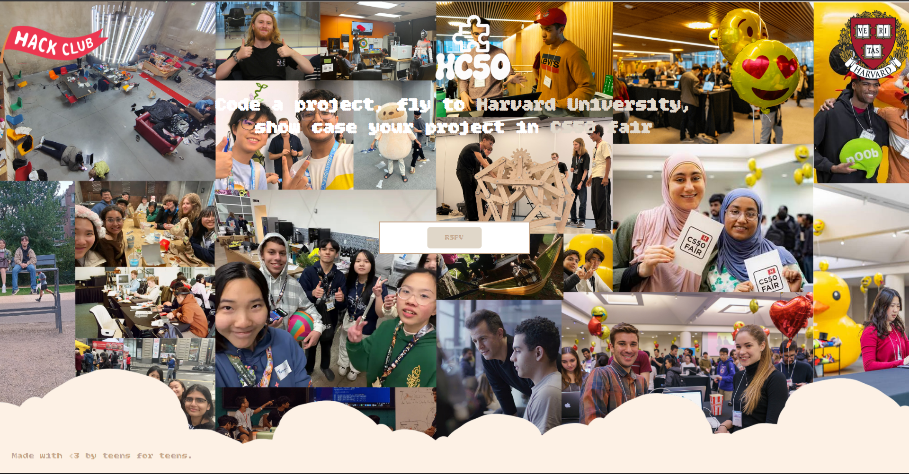

## What is this HC50 

HC50 is a ysws idea that if u code 50hrs u can fly to harvard and show case your project in cs50 fair and also can get a chance to meet the professor David J. Malan.

---

## How to run this project locally

### 1. Clone the repository

```bash
git clone https://github.com/itsketangupta/hc50.git
```

### 2. Open the project folder

```bash
cd hc50
```

### 3. Run the project

This is a simple frontend project, so you can just open the `index.html` file in your browser.

Or, if you are using VS Code:

"Open with Live Server"

---

## What I learned

as per this project nothing new i learned.

---

## Language used

* CSS 50.6%
* HTML 49.4%

---
## Preview



## Demo link 

[HC50](https://hc50-ysws.vercel.app//)

Made with <3 and by teens for teens 
